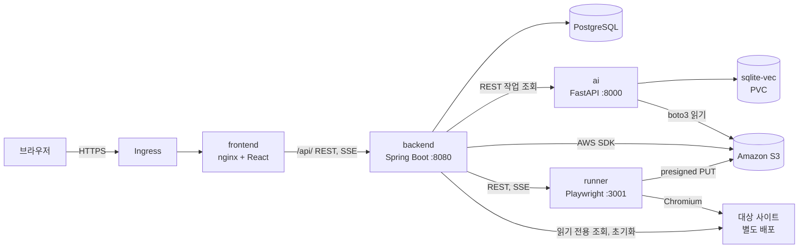

# 시스템 구조

결정 이유는 `docs/decisions.md`, 인터페이스는 `docs/contracts/`에 있다.



## 주요 흐름

```text
1. 문서 등록   UI-01    업로드 → S3 → KB 구축 작업 → AI가 S3에서 읽어 sqlite-vec 적재
2. 요청 정제   UI-02-1  자연어 → AI: RAG Top 3 근거로 후보 N개 → UI-02-1B 선택 또는 직접 입력
3. 케이스 생성 UI-02-5  선택 → AI: 시나리오·케이스 생성 ↔ 가드 검증(최대 3회) → 사용자 승인
4. 코드화      실행 전  승인 케이스 → AI: TestQuery → runner: spec.ts 변환, tsc 검사
5. 실행        UI-03    케이스마다: 초기화 → DB 조회 → runner 실행 → DB 조회 → 교차 검증 → 정리
6. 리포트      UI-04    집계는 백엔드 계산, 실패 원인 후보는 AI 분석
```

## 파이프라인 7단계 (업계 공통 루프 ↔ SKRR)

상용 AI 테스트 도구(Functionize·Mabl·testRigor·Testim 등)가 수렴하는 7단계 엔진 루프에 위 흐름을 맞춰 본 것이다. 번호는 설명용이며, 각 단계의 실제 계약은 오른쪽 문서를 따른다. 결과 관리 화면(⑦)은 TestRail 같은 상용 도구를 쓰지 않고 그 방식(실행·케이스·리포트 관리)만 차용해 플랫폼 UI로 자체 구현한다.

| 단계 | SKRR 구현 | 근거 문서 |
|---|---|---|
| ① 인식 Perceive | 문서 등록·지식 베이스(sqlite-vec RAG) + 요청 정제(Top 3 근거) | UI-01, UI-02-1 · `skrr-ai-pipeline` §1~2 |
| ② 생성 Generate | 시나리오·케이스 생성 ↔ 코드 가드(LangGraph, 최대 3회) → TestQuery | UI-02-5 · §3~4, ADR-005·ADR-014 |
| ③ 안정화 Stabilize | 데이터 초기화(SETUP)·정리(TEARDOWN), `data-testid` 가드로 선택자 고정 | `state-machines.md` 실행 순서 · `target-site-contract.md` reset |
| ④ 실행 Execute | runner: TestQuery→spec.ts→`tsc`→Playwright 실행 + 증거 수집(스크린샷·trace·HAR) | UI-03 · `runner.md` |
| ⑤ 치유 Heal | **채택하지 않음.** 깨지는 선택자를 자동 치유하는 대신 `data-testid`+가드로 환각을 원천 차단하고, 요소가 없으면 `CATALOG_GAP`으로 사용자에게 카탈로그 수정을 요청한다 | ADR-005 |
| ⑥ 분석 Analyze | 규칙 기반 `failureType` 분류 + 교차 검증(화면·API·DB) → LLM 원인 후보 → 근거 검사 | UI-04 · §5 |
| ⑦ 보고 Report | 자체 플랫폼 UI(실행 모니터·결과 리포트)로 집계·원인·증거 표시. 상용 결과 관리 도구 미사용 | UI-03, UI-04 |

⑤를 비운 것은 이 프로젝트의 설계 선택이다. 상용 도구의 self-heal은 선택자 환각을 사후에 교정하지만, SKRR은 생성 시점에 카탈로그 가드로 막아 같은 문제를 앞단에서 없앤다(ADR-005). 치유로 실패를 "지나가게" 만들어 생기는 불안정(flaky)을 성공 기준의 오탐률 산정에서 배제하려는 의도이기도 하다.

## 서비스별 책임

| 서비스 | 맡는 일 | 맡지 않는 일 |
|---|---|---|
| frontend | 화면, SSE 표시 | AI·실행기 직접 호출 |
| backend | 업무 상태와 DB, S3 파일, 실행 제어, DB 교차 검증, 리포트 집계 | 프롬프트, LLM 호출 |
| ai | 문서 파싱, RAG, 요청 정제, 시나리오·TestQuery 생성, 가드, 원인 분석 | DB 쓰기, 코드 실행 |
| runner | TestQuery 변환·문법 검사·실행, 증거 수집 | LLM 호출, DB·AWS 자격 증명 보유 |
| infra | 이미지, 매니페스트, 네트워크 정책, 시크릿 구조 | 업무 로직 |

## S3 키 구조

아키텍처 그림의 세 폴더에 `test-data/`와 `run-artifacts/`를 더했다.

```text
requirements/{projectId}/{uuid}_{파일명}
api-specs/{projectId}/{uuid}_{파일명}
catalog/{projectId}/{uuid}_{파일명}
test-data/{projectId}/{uuid}_{파일명}
run-artifacts/{runId}/{caseResultId}/attempt-{n}/trace.zip | network.har | step-{order}.png
```

## 런타임 설정

서비스 사이에서 이름이 어긋나기 쉬우므로 여기를 기준으로 한다. 값은 `.env`나 쿠버네티스 Secret에 두고 저장소에 커밋하지 않는다.

| 변수 | 사용 서비스 | 비밀 | 설명 |
|---|---|---|---|
| `SPRING_DATASOURCE_URL`, `SPRING_DATASOURCE_USERNAME`, `SPRING_DATASOURCE_PASSWORD` | backend | 비밀번호 | DB 접속 |
| `AWS_REGION` | backend, ai | | 기본 `ap-northeast-2` |
| `S3_BUCKET` | backend, ai | | 문서와 증거 버킷 |
| `AWS_ACCESS_KEY_ID`, `AWS_SECRET_ACCESS_KEY` | backend, ai | 예 | 클러스터 신원 연동을 쓰면 생략 |
| `AI_SERVER_URL` | backend | | 기본 `http://ai:8000` |
| `RUNNER_URL` | backend | | 기본 `http://runner:3001` |
| `TEST_CONTROL_TOKEN` | backend | 예 | 대상 사이트 초기화 API 토큰 |
| `LLM_PROVIDER`, `LLM_MODEL`, `EMBEDDING_MODEL` | ai | | ADR-010 |
| `LLM_API_KEY` | ai | 예 | 호스팅 API를 쓸 때만 |
| `LLM_BASE_URL` | ai | | Ollama 등을 쓸 때만 |
| `KB_DATA_DIR` | ai | | 기본 `/data/kb` |
| `RUNNER_ALLOWED_TARGET_HOSTS` | runner | | 쉼표 구분. 허용 대상 호스트 |

## 업로드와 시간 제한

값이 여러 곳에 흩어져 있어 함께 바꿔야 한다.

| 항목 | 값 | 설정 위치 |
|---|---|---|
| 업로드 파일 크기 | 20MB | UI-01 안내, Spring `max-file-size` |
| 업로드 요청 본문 | 21MB (multipart 오버헤드 포함) | 프론트 nginx `client_max_body_size`, Spring `max-request-size` |
| SSE 읽기 제한 | 3600초, 버퍼링 끔 | 프론트 nginx (Ingress 통과 여부는 실제 스트림으로 확인) |
| LLM 호출 | 60초, 재시도 3회 (지수 백오프) | ai |
| 가드 재생성 | 최대 3회 | ai, UI-02-5 표시 |
| 케이스 1회 실행 | 120초 | backend → runner |
| 실패 재현 | 최대 3회 | backend |
