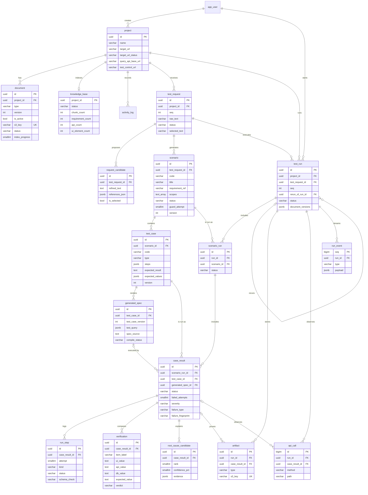

# 플랫폼 ERD 초안 v0.1

컬럼 정의의 기준은 `docs/contracts/schema.sql`이다. 이 문서는 관계와 설계 이유를 설명한다. 대상 사이트(목업 쇼핑몰)의 ERD는 별도 산출물(WBS 4.2.1)이며 여기에 포함하지 않는다.



`app_user`, `activity_log`, `async_job`은 단순하거나 다른 테이블과 ID로만 이어지므로 컬럼을 생략했다. `async_job`은 외래 키 없이 `subject_type`, `subject_id`로 대상을 가리킨다.

## 설계 이유

| 결정 | 이유 |
|---|---|
| 표시 코드(`REQ-0142`, `SC-01`, `TC-12`, `RUN-0318`)와 UUID 분리 | 화면은 짧은 코드를 쓰고, API 경로는 추측 불가능한 ID를 쓴다 |
| `TC` 번호는 요청 단위로 연속 | UI-02-5의 `TC-01`과 UI-04의 `TC-12`가 같은 체계로 읽히게 한다 |
| 문서와 시나리오, 케이스에 `version` | 어떤 문서·내용으로 실행했는지 리포트에 남긴다 (UI-04 "요구사항 v3 · API v2 · 카탈로그 v2") |
| `generated_spec`을 케이스 버전별로 저장 | 승인 후 내용이 안 바뀌었으면 재실행 때 LLM을 다시 호출하지 않는다. 재실행 결과의 차이가 코드 생성 때문이 아니라 대상 사이트 때문임을 보장한다 |
| 재현 시도별 `run_step.attempt` | "3회 중 3회"와 재현 단계를 같은 데이터로 만든다 |
| `failure_fingerprint` | 이전 실행 대비 "새로운 실패 / 계속 실패 / 해결됨"을 계산한다 |
| `run_event` 저장 | SSE 재연결 시 유실 없이 복구하고, 끝난 실행의 로그도 같은 데이터로 본다 |
| 벡터 데이터는 DB에 두지 않음 | WBS 4.5.2가 `sqlite-vec`를 지정했다. `knowledge_base`는 상태와 통계만 보관한다 |
| 파일 본문은 S3, `artifact`와 `document`는 위치만 저장 | 아키텍처 그림과 같고, DB 크기를 작게 유지한다 |

## 검증 방법

```bash
python3 .claude/skills/skrr-integration-qa/scripts/check_contracts.py
```

`schema.sql`의 CHECK 값과 OpenAPI enum이 다르면 실패한다. DDL은 2026-11-09에 임시 PostgreSQL 17에서 적용과 주요 제약 동작을 확인했다. 목표 버전인 16에서는 아직 실행하지 않았다.

## 담당자 검토 필요

이 문서는 하네스가 만든 초안이다. 팀 역할상 ERD 담당은 황민채, API 명세 담당은 박영서이므로 두 담당자의 검토를 거쳐 확정한다.
